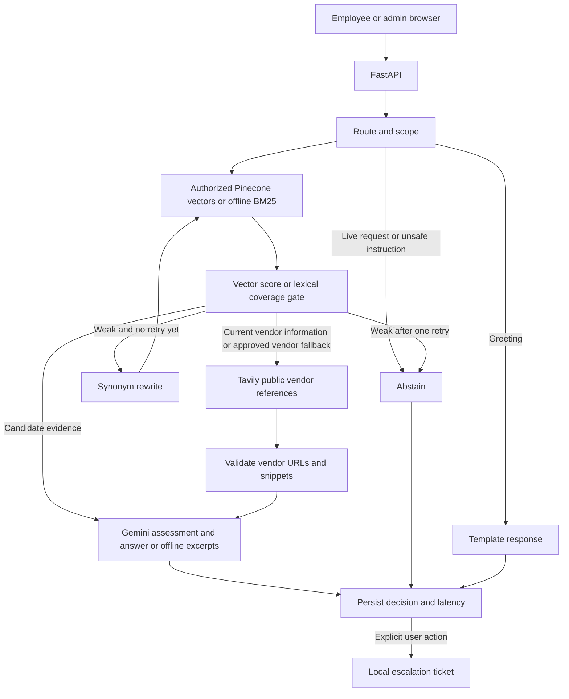

# Northstar Internal IT Support Copilot

**Version 0.7 adds Neon PostgreSQL persistence.** Sessions, tickets, documents and vector metadata can survive host restarts and redeploys. The SQLite importer preserves existing IDs and corpus identity, verifies every copied record, and keeps a local backup. See [PostgreSQL setup and migration](docs/postgres.md).

This workspace is now running on Neon. **144 automated tests passed**, including real PostgreSQL branch tests. The live Gemini/Pinecone acceptance check verified the migrated ticket and completed a new resolved troubleshooting session against PostgreSQL without creating another ticket. See [validation evidence](docs/validation.md).

For public hosting, use the free-plan [Render Blueprint](render.yaml) and [Render deployment guide](docs/render.md). Hosting support adds dynamic port/hostname configuration, secure cookies, a private secret-file option and basic public-demo request limits.

**Your Internal IT Partner.** Version 0.6 restores IT support as the main app and adds saved guided troubleshooting for Teams microphone, VPN, and account access. Retail is removed from the UI; its earlier backend, data and tests are retained separately.

Start with **Fix a Teams issue**, select your operating system, and use **Tried it — still not working** to advance through verified runbook steps. The app remembers your answers and attempted steps after reload. Choose **Review ticket & escalate** to inspect the handoff, then **Create local ticket**. An IT administrator can open its full handoff from **Activity & tickets**. Tickets stay local and do not contact an external support team. See the [guided troubleshooting guide](docs/guided-support.md).

The v0.6 full suite passed **136 tests**, using local HTTP simulations for provider regressions. Live browser verification also completed a Gemini/Pinecone Teams troubleshooting session and explicit local ticket creation. See [validation evidence](docs/validation.md) for scope and limitations.

A local IT support product for a fictional retail customer, built as a Forward Deployed Engineering portfolio project. It turns company runbooks into cited support responses, explains its retrieval decisions, and hands unsupported questions to an explicit local ticket workflow.

The original offline baseline passed 31 tests including eight Ollama HTTP simulation cases, plus 16/16 fixed evaluation cases. The cloud upgrade adds separate integration tests and a live acceptance script. See [validation scope](docs/validation.md).

**This workspace now uses Gemini + Pinecone:** Gemini generates both embeddings and answers, and Pinecone performs vector retrieval. Credentials are stored only in the gitignored `.env`. No OpenAI key is used. The UI runs locally; cloud mode sends questions and document text to Gemini and vectors with access metadata to Pinecone. See [cloud setup](docs/cloud-setup.md).

The offline SQLite/excerpt baseline and optional Ollama generation remain available. The interface labels the configured backend and each response's actual generation mode.

Version 0.3 added bounded Gemini timeout recovery and a question-preserving retry action. Version 0.4 adds optional Tavily public vendor search with external citations and privacy-preserving query templates. The version 0.4 suite passed **90 automated tests**, and the live Tavily smoke run passed **2/2** checks. See [web search setup](docs/web-search.md), [timeout settings](docs/cloud-setup.md#timeout-recovery--version-03), and [validation history](docs/validation.md).

Inspired by the problem and workflow in [Enterprise IT Support Agentic RAG Copilot](https://github.com/entbappy/Enterprise-IT-Support-Agentic-RAG-Copilot). This is an original implementation with original fictional documents, UI, and tests; no upstream source code was copied.

## Run on Windows

Python 3.10 or newer is required. From this project directory:

```powershell
python -m venv .venv
.\.venv\Scripts\python.exe -m pip install -r requirements.lock
.\.venv\Scripts\python.exe run.py
```

Open **http://127.0.0.1:8000**. API documentation is at **http://127.0.0.1:8000/docs**. The app automatically loads six fictional documents: five employee documents and one restricted IT runbook. The virtual environment is already installed in the current workspace. Cloud mode requires the initial vector sync in [cloud setup](docs/cloud-setup.md); this has already been performed in the current workspace.

On later runs, use `Start-Copilot.ps1` or `.\.venv\Scripts\python.exe run.py`. Stop the foreground server with Ctrl+C. No Node build is needed.

To unlock administration, read the generated key locally:

```powershell
Get-Content .runtime\admin-key
```

Click the employee profile at the bottom left and paste the key. It is held in tab memory and disappears on reload. You can alternatively set `APP_ADMIN_KEY` in `.env`; when set, that value takes precedence over the generated key file. `.env` and all runtime files are gitignored.

## Try a five-minute demo

1. Ask **How do I connect to the company VPN from home?** Inspect the cited excerpts and the route → retrieve → grade → answer trace. Open a source to inspect the full document.
2. Ask **Can IT support ask me to share my MFA code?** The source says never to share codes.
3. Ask **I am away from the office and need secure access to our internal apps. What steps should I follow?** This demonstrates cloud semantic retrieval. In offline mode, **2fa** demonstrates the bounded synonym retry to MFA.
4. Ask **What is the latest official Microsoft Teams microphone troubleshooting guidance?** With Tavily enabled, inspect the external-source warning, official URL, retrieval timestamp, and web-search trace. Public search is not tenant-specific outage telemetry. With web search disabled, current-information questions abstain.
5. Ask **break glass account review** in employee mode. The restricted runbook is excluded before retrieval. Unlock admin and ask again to see authorized evidence.
6. As admin, open **Knowledge base → Add document** and upload `data/demo_upload/warehouse_printers.md`. Ask **Zebra label calibration**. Cloud uploads generate embeddings and sync vectors. Allow a few seconds for Pinecone query visibility. Retry pending indexing using **Sync vectors**.
7. Open **Activity & tickets** to inspect the audit and local handoff. Open **Evaluations → Run evaluation** for the fixed regression suite.

The main chat uses a browser-owned troubleshooting session. Follow-ups include the original issue, known facts, attempted steps, and recent conversation context. **New conversation** starts a separate session; it does not delete stored sessions or audit records. The legacy `/api/chat` endpoint remains a stateless RAG API.

## What is implemented

| Capability | Implementation |
|---|---|
| Product UI | Responsive local HTML/CSS/JavaScript, no CDN assets |
| API | FastAPI, validated inputs, generated OpenAPI contract |
| Workflow | LangGraph conditional edges, one bounded synonym rewrite |
| Retrieval | Pinecone cosine search over Gemini embeddings; offline SQLite BM25 option |
| Public vendor search | Optional Tavily search using fixed public query templates and checked official-domain URLs |
| Evidence gate | Vector score followed by Gemini support assessment; offline lexical coverage |
| Cloud answer | Gemini structured support decision and generated answer with validated source IDs |
| Offline answer | Original excerpts with document/chunk citations |
| Optional generation | Ollama non-streaming chat; validates citation identifiers and falls back to excerpts on failures |
| Ingestion | UTF-8 Markdown/text, 1 MB limit, heading-aware chunks, scope-aware content-hash deduplication |
| Access scope | Employee or IT admin; admin identity comes from a validated header, never request text |
| Persistence | SQLite WAL for documents/audits; embedding cache, idempotent vector sync, durable deletion outbox |
| Operations | Audit records, aggregate metrics, explicit idempotent local ticket creation |
| Evaluation | Synthetic regression fixtures, separate from support traffic metrics |
| Packaging | Pinned dependency snapshot, Docker/Compose, CI checks |

This is a **graph-controlled retrieval workflow**. Routing and bounded synonym rewriting use rules. Cloud mode uses Gemini embeddings for semantic retrieval, then Gemini assesses whether the passages support an answer before generating. Vector similarity and lexical coverage are heuristics, not probabilities of correctness.

## Architecture



Read [the customer brief](docs/customer-brief.md), [architecture decisions](docs/architecture.md), [test evidence](docs/validation.md), and [operations runbook](docs/runbook.md) for the FDE story and known tradeoffs.

## Test and evaluate

```powershell
.\.venv\Scripts\python.exe -m pytest -q
.\.venv\Scripts\python.exe scripts\evaluate.py
node --check static\app.js
.\.venv\Scripts\python.exe scripts\export_openapi.py
```

The evaluator uses the configured backend; with cloud settings it makes real provider calls. It writes `.runtime/evaluation.json` and stores the latest report for the admin UI without adding support query records. The rewrite assertion applies only to offline mode. Fixed phrase checks can reject a valid generated paraphrase. Passing these synthetic cases is not evidence of general accuracy or customer ticket deflection.

`app/main.py` and its Pydantic schemas are authoritative for the API. `docs/openapi.json` is generated from them. Re-export it after contract changes. The optional HTTP adapter has a separate local Postman simulation; see [provider testing](docs/provider-testing.md).

## Optional local LLM

Install [Ollama from its official site](https://ollama.com/download), then download a model that fits your machine:

```powershell
ollama pull llama3.2:3b
# For a new checkout only: copy .env.example to .env.
# Preserve an existing .env containing your cloud keys.
```

Set `ANSWER_MODE=ollama` in `.env`, ensure Ollama is serving on `http://127.0.0.1:11434`, and restart the app. Set `OLLAMA_MODEL` to another installed model if desired. The first model download needs internet and several GB of disk/RAM; performance depends on your hardware. The app uses the [documented Ollama chat API](https://docs.ollama.com/api/chat).

If an Ollama request fails or has invalid citations, it falls back to original excerpts with a warning. Citation validation does **not** prove factual entailment. No live Ollama model was run; live Gemini verification is recorded separately in [validation](docs/validation.md).

## Docker

```powershell
docker compose up --build
docker compose exec copilot cat .runtime/admin-key
```

Compose exposes only `127.0.0.1:8000` and persists data in a named volume. Docker packaging is included; consult `docs/validation.md` for whether it was actually built in this environment. Native Python is the verified path. Docker's default answer mode is extractive. Running Ollama outside a container needs a separately configured reachable URL.

## Local-demo boundaries

- Employee access is anonymous and shared. The admin key is a local capability, not enterprise SSO. Bind to loopback; do not publicly deploy this demo as-is.
- Documents are trusted admin inputs. Rule matching blocks a few obvious hostile user requests; it is not comprehensive prompt-injection detection. The optional model has no tool execution privileges.
- Both vector thresholds and lexical coverage are heuristics. Gemini adds a support assessment, but no independent entailment verifier proves every generated claim.
- Tavily supports scoped public vendor research. Search snippets do not provide authenticated tenant status or guarantee the newest publication. Jira/ServiceNow integration, PDF/DOCX parsing, per-user identity, streaming, and production deployment are not implemented. No external ticket writes are simulated as real operations.
- Audit records redact common email and `password=value` patterns. This is best-effort redaction, not a DLP system. Uploaded documents, citations, and model responses are stored locally in SQLite. Use only synthetic data.
- Conversations and local tickets are shared within the demo. A run identifier is a local capability for creating an employee ticket; it is not user ownership enforcement.
- Sample documents are idempotently seeded on every startup. Deleting a seeded document removes it for that run; restarting restores it from `data/knowledge`. Uploaded documents persist until deleted.
- The fixed evaluation suite assumes the seeded corpus. Changing or deleting seed documents can change its results.

## Portfolio positioning

Describe what you can demonstrate: a customer problem translated into a working support workflow, protected knowledge ingestion, inspectable decisions, failure handling, local persistence, a repeatable evaluation, and a deployment handoff. Use measured fixture results with their scope. Do not claim production adoption, autonomous remediation, revenue impact, or ticket-deflection savings that have not been measured.

Suggested next iteration: collect a larger independent paraphrase/negative test set, compare the implemented BM25 and Gemini/Pinecone paths, calibrate abstention with human labels, connect enterprise identity, and implement one approved service-desk integration.
